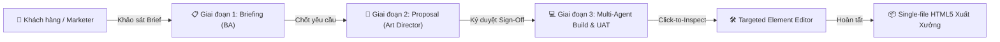
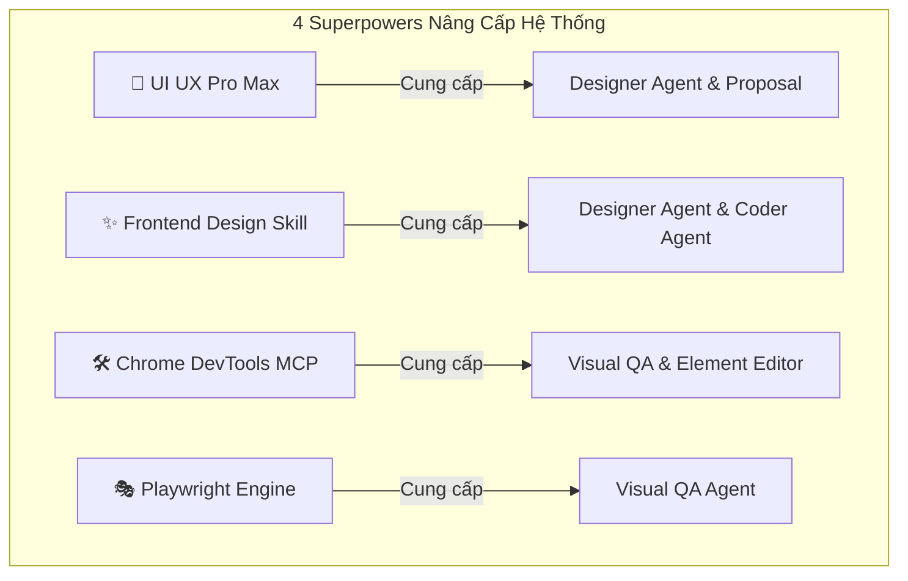
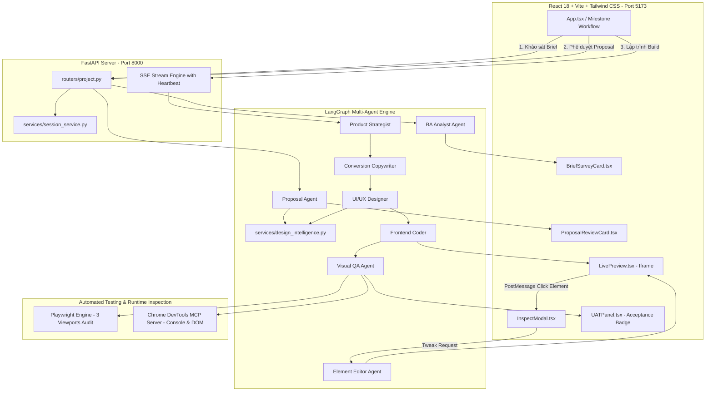

# Kiến Trúc Hệ Thống & Hướng Dẫn Triển Khai
## Multi-Agent Landing Page Builder (LandingCraft)

> **Tài liệu toàn diện về kiến trúc kỹ thuật, quy trình phối hợp 8 Agent, 4 năng lực chuyên sâu (Superpowers), bộ đo lường Benchmark Harness và quy trình vận hành triển khai production.**

---

## 1. Tổng Quan Dự Án & Tầm Nhìn

**LandingCraft** là nền tảng Full-stack thế hệ mới ứng dụng mô hình điều phối đa tác nhân (Multi-Agent System) dựa trên LangGraph, FastAPI và React/Tailwind. Thay vì sử dụng mô hình "hộp đen" tạo trang web tự động đơn lẻ thường sinh ra mã nguồn rập khuôn (AI-slop), hệ thống áp dụng **Quy trình Hợp tác Agency 3 Giai đoạn (Human-in-the-Loop Milestone Workflow)**:
1. Người dùng làm việc trực tiếp với **BA Analyst Agent** để khảo sát làm rõ yêu cầu nghiệp vụ qua 3 câu hỏi cốt lõi.
2. **Proposal Agent** xây dựng Bản đề xuất kiến trúc & thiết kế toàn diện để khách hàng ký duyệt (Sign-Off) trước khi bắt tay lập trình.
3. Khi đã đồng thuận, hệ sinh thái các Agent chuyên sâu (Strategist, Copywriter, Designer, Coder, Visual QA, Element Editor) cùng phối hợp sản sinh tệp Single-file HTML5 độc bản, được kiểm thử tự động bởi **Playwright** và **Chrome DevTools MCP**.



---

## 2. Quy Trình 3 Giai Đoạn (Human-in-the-Loop Milestones)

### Giai đoạn 1: Khảo sát & Phân tích Nghiệp vụ (BA Briefing)
- **Agent điều phối:** `BAAnalystAgent` ([`ba_analyst.py`](file:///home/tuananh/GEN_LANDING/backend/app/agents/ba_analyst.py)).
- **Cơ chế hoạt động:** Tiếp nhận ý tưởng ban đầu của người dùng, phân tích và tạo ra đúng 3 câu hỏi nghiệp vụ mang tính định hướng:
  1. `target_audience`: Đối tượng khách hàng mục tiêu cụ thể là ai?
  2. `brand_style`: Phong cách thị giác & cảm xúc thương hiệu mong muốn?
  3. `conversion_goal`: Mục tiêu hành động chuyển đổi chính (Primary CTA)?
- **Trải nghiệm người dùng:** Mỗi câu hỏi có sẵn 4 `quick_options` được cá nhân hóa theo đề bài giúp người dùng bấm chọn ngay trong 1 click hoặc tự nhập câu trả lời.

### Giai đoạn 2: Phê Duyệt Đề Xuất Thiết Kế & Kiến Trúc (Proposal Sign-Off)
- **Agent điều phối:** `ProposalAgent` ([`proposal_agent.py`](file:///home/tuananh/GEN_LANDING/backend/app/agents/proposal_agent.py)).
- **Cơ chế hoạt động:** Tổng hợp câu trả lời Briefing, tra cứu thư viện thiết kế UI UX Pro Max để tạo bản Đề xuất hoàn chỉnh (`DesignProposal`):
  - Định vị chân dung khách hàng & Tuyên ngôn giá trị (Value Proposition).
  - Dàn ý 6 Section chuẩn mực (Hero, Social Proof, Features, Pricing, FAQ, Final CTA).
  - Bảng màu 5 màu chuẩn HEX theo quy tắc 60-30-10 (`primary`, `secondary`, `accent`, `background`, `surface`).
  - Cặp font Google Fonts tối ưu khả năng đọc.
- **Trải nghiệm người dùng:** Người dùng có thể **Phê duyệt (Approve)** hoặc gửi **Yêu cầu điều chỉnh (Feedback)** để Agent cập nhật lại bản đề xuất.

### Giai đoạn 3: Lập Trình Đa Tác Nhân & Nghiệm Thu Tương Tác (Build & Interactive UAT)
- **Agent điều phối:** LangGraph StateGraph (Strategist -> Copywriter -> Designer -> Coder -> Visual QA).
- **Trải nghiệm người dùng:**
  - SSE Streaming hiển thị tiến độ thời gian thực của từng Agent kèm thanh tiến trình trực quan.
  - Iframe Live Preview render mã nguồn tức thì, hỗ trợ 3 chế độ xem: **Desktop (1280px)**, **Tablet (768px)**, **Mobile (375px)**.
  - Bảng nghiệm thu UAT hiển thị huy hiệu kiểm định thời gian thực từ Chrome DevTools MCP (số lỗi Console) và Playwright (Trạng thái tràn viền di động 375px, tương tác CTA).
  - Công cụ **Chrome DevTools Click-to-Inspect**: Nhấp vào bất kỳ nút bấm, tiêu đề hoặc thẻ nào trên iframe để sửa riêng phần tử đó mà không làm hỏng toàn bộ trang web.
  - Hỗ trợ **Undo / Redo** lịch sử các phiên bản và tải về `index.html` độc lập chỉ với 1 cú click.

---

## 3. Hệ Sinh Thái 8 AI Agents Chuyên Sâu

| # | Agent Name | Module | Trách nhiệm chính |
| :-: | :--- | :--- | :--- |
| **1** | **BA Analyst** | `ba_analyst.py` | Phân tích đề bài, tạo 3 câu hỏi khảo sát nghiệp vụ có sẵn gợi ý 1-click. |
| **2** | **Proposal Agent** | `proposal_agent.py` | Lập bản kế hoạch kiến trúc & Design System toàn diện trình khách hàng duyệt. |
| **3** | **Product Strategist** | `strategist.py` | Xây dựng dàn ý cấu trúc tối ưu tỷ lệ chuyển đổi (CRO Blueprint) 10 phần. |
| **4** | **Conversion Copywriter** | `copywriter.py` | Viết tiêu đề Hero, tuyên ngôn giá trị, lợi ích sản phẩm, lời chứng thực và FAQs. |
| **5** | **UI/UX Designer** | `designer.py` | Ứng dụng UI UX Pro Max: chọn phong cách UI, bảng màu 60-30-10, typography và Tailwind tokens. |
| **6** | **Frontend Coder** | `coder.py` | Thấm nhuần Frontend Design Skill: viết mã HTML5 single-file độc bản, bố cục Bento, nạp CDN Tailwind & Lucide. |
| **7** | **Visual QA Agent** | `visual_qa.py` | Kiểm định tĩnh cấu trúc HTML5, chạy Playwright kiểm tra 3 viewport & dùng Chrome DevTools MCP bắt lỗi console. |
| **8** | **Element Editor** | `element_editor.py` | Nhận diện phần tử qua click-to-inspect và viết lại mã HTML/Tailwind chính xác theo yêu cầu người dùng. |

---

## 4. Tích Hợp 4 Nguồn Năng Lực Chuyên Sâu (Superpowers)



### 1. UI UX Pro Max (Tư Duy Thiết Kế Chuẩn Mực)
- **Quy tắc phối màu 60-30-10:**
  - 60% Không gian nền canvas (`background`, `surface`).
  - 30% Cấu trúc phụ (`secondary`, đường viền tinh tế 1px, văn bản nội dung).
  - 10% Điểm nhấn chuyển đổi (`primary` - nút CTA chính).
- **Thư viện 6 phong cách thị giác cao cấp:**
  - `modern_saas`: Sạch sẽ, đường viền tối giản, độ tin cậy doanh nghiệp cao.
  - `bento_grid`: Bố cục chia ô modular linh hoạt, thẻ tiêu điểm bất đối xứng.
  - `dark_cyberpunk`: Đen vũ trụ, viền neon cyber cyan/rose, độ tương phản sắc bén.
  - `minimal_editorial`: Khoảng thở rộng rãi, kiểu chữ serif/sans sang trọng, thanh lịch.
  - `warm_creator`: Tông màu ấm áp, thân thiện, cộng đồng và giáo dục.
  - `neo_brutalism`: Viền đen 2px tương phản cao, đổ bóng cứng `shadow-[4px_4px_0px_#000]`.
- **Tuyển tập Font Pairings:** `Outfit + Inter`, `Space Grotesk + Plus Jakarta Sans`, `Syne + DM Sans`, `Cormorant Garamond + Montserrat`.
- **Tiêu chuẩn tương phản:** Đạt chuẩn **WCAG AA** (tối thiểu 4.5:1 đối với văn bản thông thường).

### 2. Frontend Design Skill (Triệt Tiêu AI-Slop & Tôn Vinh Tính Thủ Công)
- **Anti-AI Slop Directives:**
  - Tuyệt đối cấm gradient tím-hồng generic mòn mắt.
  - Cấm tô màu riêng một chữ đơn lẻ trong tiêu đề (`<span class="gradient">Từ Này</span>`).
  - Cấm gắn nhãn viết hoa toàn bộ (ALL-CAPS) trên đầu mọi thẻ nội dung không cần thiết.
  - Cấm gắn số thứ tự 01, 02, 03 nếu nội dung không phải quy trình các bước tuần tự.
  - Cấm hoạt ảnh fade-in/slide-up rải rác trên mọi khối gây chóng mặt; chỉ giữ một hiệu ứng xuất hiện có chủ đích (*orchestrated motion*).

### 3. Chrome DevTools MCP (Kiểm Định Trực Tiếp Qua Giao Thức CDP)
- Hệ thống tích hợp máy khách stdio MCP client ([`devtools_mcp_client.py`](file:///home/tuananh/GEN_LANDING/backend/app/services/devtools_mcp_client.py)) kết nối trực tiếp với server chính thức `@modelcontextprotocol/server-chrome-devtools`:
  - `navigate_page`: Điều hướng trang web trong môi trường Headless Chrome độc lập.
  - `list_console_messages`: Trích xuất toàn bộ log console với bộ lọc type `["error"]`.
  - `resize_page`: Co dãn kích thước trang sang chuẩn di động (375x812px).
  - `evaluate_script`: Đo đạc trực tiếp các thuộc tính DOM (`scrollWidth > clientWidth`) để phát hiện tràn viền ngang.

### 4. Playwright Multi-Viewport & Interactive Smoke Testing
- Module [`chrome_inspector.py`](file:///home/tuananh/GEN_LANDING/backend/app/services/chrome_inspector.py) tích hợp `playwright.async_api`:
  - **Kiểm thử 3 khung nhìn thực tế:** Desktop (1280x800), Tablet (768x1024), và Mobile (375x812).
  - **Interactive CTA Smoke Test:** Tự động định vị và click thử nút CTA chính (`#hero-cta-btn`) để bảo đảm phần tử không bị che khuất và không gây crash runtime.
  - **Kiểm tra Icon:** Xác nhận script `lucide.createIcons()` thực sự đã render các thẻ `<svg>` trên cây DOM.

---

## 5. Kiến Trúc Kỹ Thuật Chi Tiết (Technical Architecture)



### Chi tiết luồng truyền thông & Đồng bộ
1. **Server-Sent Events (SSE) với Keep-Alive Shield:**
   - Để ngăn chặn việc kết nối HTTP bị timeout hoặc ngắt giữa chừng trong quá trình LLM sinh mã HTML lớn, backend sử dụng cơ chế `run_node_with_heartbeat` chạy tiến trình trên worker thread độc lập (`asyncio.to_thread`), định kỳ phát tín hiệu `: keep-alive\n\n` mỗi 8 giây.
2. **Click-to-Inspect qua PostMessage an toàn:**
   - Iframe preview được nhúng một đoạn script inspector nhẹ: khi bật chế độ Inspect, hover vào phần tử sẽ hiển thị hộp khung viền xanh (`highlight box`), nhấp chuột sẽ gửi thông điệp `postMessage` chứa `tag`, `id`, `classes` và `outerHTML` ra cửa sổ cha React.
3. **Quản lý phiên bản Undo / Redo:**
   - Dịch vụ [`session_service.py`](file:///home/tuananh/GEN_LANDING/backend/app/services/session_service.py) duy trì danh sách snapshot các bản HTML trong bộ nhớ session, hỗ trợ hoàn tác và làm lại tức thời với độ trễ 0ms.

---

## 6. Bộ Đo Lường Chất Lượng: Agent Benchmark Harness

Hệ thống sở hữu bộ công cụ kiểm thử & benchmark độc lập tại [`backend/app/harness/`](file:///home/tuananh/GEN_LANDING/backend/app/harness/):

### Rubrics Chấm Điểm 0–100 Điểm
- **BA Analyst (100đ):** Schema JSON (30đ), Phủ đủ 3 câu hỏi cốt lõi (40đ), Chất lượng gợi ý nhanh (30đ).
- **Proposal Agent (100đ):** Schema đầy đủ (30đ), Bảng màu 5 mã HEX chuẩn (25đ), Dàn ý >= 5 sections (25đ), Typography & Tone (20đ).
- **Strategist (100đ):** Độ phủ các khối CRO (50đ), Độ sâu phân tích >= 300 ký tự (30đ), Hướng tới khách hàng mục tiêu (20đ).
- **Copywriter (100đ):** Tiêu đề Hero (25đ), Nút CTA rõ ràng (25đ), Bằng chứng tin cậy (30đ), FAQ hoàn chỉnh (20đ).
- **Designer (100đ):** Màu sắc cụ thể (30đ), Hướng dẫn font chữ (25đ), Bố cục & khoảng cách (25đ), Hiệu ứng thị giác (20đ).
- **Coder (100đ):** Cấu trúc chuẩn HTML5 (30đ), Nhúng CDN Tailwind & Lucide (25đ), ID ngữ cảnh DevTools (20đ), Khởi tạo Icon & Responsive (15đ), Không dính markdown backticks (10đ).
- **Visual QA (100đ):** Kiểm tra cú pháp (40đ), Telemetry DevTools/Playwright (40đ), Kết luận nhất quán với lỗi thực tế (20đ).
- **Element Editor (100đ):** Chỉ xuất phần tử mục tiêu (40đ), Tuân thủ yêu cầu sửa (30đ), Giữ nguyên cú pháp & ID (30đ).

### Bộ Dữ Liệu Benchmark Chuẩn
Gồm 5 kịch bản đại diện các ngành nghề tại [`fixtures.py`](file:///home/tuananh/GEN_LANDING/backend/app/harness/fixtures.py):
1. `b2b_saas`: TalentAI - Tuyển dụng tự động bằng AI.
2. `ecommerce_fashion`: StreetVibe - Thời trang dạo phố Cyberpunk.
3. `online_education`: ProDev Bootcamp - Khóa học lập trình Full-Stack.
4. `creative_agency`: NovaStudio - Thiết kế thương hiệu cao cấp.
5. `edge_cases`: Prompt cực ngắn, kiểm tra khả năng phục hồi và chống crash.

### Lệnh Thực Thi Benchmark
```bash
# 1. Chạy Benchmark toàn bộ suite (Chế độ Mock tốc độ cao cho CI/CD)
python3 scripts/run_agent_benchmark.py

# 2. Chạy Sandbox với Live LLM và Browser thực tế
python3 scripts/run_agent_benchmark.py --agent visual_qa --case b2b_saas --live
python3 scripts/run_agent_benchmark.py --agent element_editor --case b2b_saas --live
```
*Báo cáo kết quả được tự động kết xuất ra tệp Markdown trực quan tại:* [`docs/benchmarks/benchmark_latest.md`](file:///home/tuananh/GEN_LANDING/docs/benchmarks/benchmark_latest.md).

---

## 7. Hướng Dẫn Cài Đặt & Khởi Chạy (Operations Guide)

### 7.1 Yêu Cầu Môi Trường
- **Hệ điều hành:** Linux (Ubuntu 20.04+, Debian, Fedora) hoặc macOS / Windows WSL2.
- **Python:** 3.10 trở lên.
- **Node.js:** v18.0.0 trở lên & npm.
- **Google Chrome / Chromium:** Đã cài đặt trên máy.

### 7.2 Cấu Hình Môi Trường (.env)
Tạo file `.env` từ file mẫu `.env.example` (Lưu ý: Không bao giờ commit file `.env` lên git):
```bash
cp .env.example .env
```
Nội dung file `.env`:
```env
# Google Gemini API Key hoặc 9router Token
GEMINI_API_KEY=your_gemini_api_key_here

# Model LLM sử dụng (khuyên dùng gemini-3.8-flash hoặc gemini-3.8-flash-high)
GEMINI_MODEL=ag/gemini-3.8-flash-high

# Cổng Local Gateway (nếu dùng 9router, để trống nếu gọi trực tiếp Google)
LLM_BASE_URL=http://localhost:20128/v1

# Cấu hình máy chủ Backend
HOST=0.0.0.0
PORT=8000
```

### 7.3 Cài Đặt Thư Viện

**Backend:**
```bash
cd backend
pip install -r requirements.txt
playwright install chromium
```

**Frontend:**
```bash
cd frontend
npm install
```

### 7.4 Khởi Chạy Môi Trường Phát Triển (Development)

**Terminal 1: Chạy Backend FastAPI**
```bash
cd backend
python3 -m uvicorn app.main:app --host 0.0.0.0 --port 8000 --reload
```
*Kiểm tra sức khỏe Backend:* `curl http://localhost:8000/api/health`

**Terminal 2: Chạy Frontend Vite**
```bash
cd frontend
npm run dev
```
*Truy cập ứng dụng tại:* `http://localhost:5173`

---

## 8. Hướng Dẫn Triển Khai Môi Trường Sản Xuất (Production Deployment)

### 8.1 Build Bản Tĩnh Frontend
```bash
cd frontend
npm run build
```
Mã nguồn tĩnh sẽ được tối ưu và đóng gói vào thư mục `frontend/dist/`.

### 8.2 Cấu Hình Nginx Reverse Proxy
Mẫu cấu hình Nginx phục vụ frontend tĩnh và proxy các request `/api/` tới FastAPI:
```nginx
server {
    listen 80;
    server_name landingcraft.yourdomain.com;

    # Phục vụ Frontend React tĩnh
    location / {
        root /home/tuananh/GEN_LANDING/frontend/dist;
        try_files $uri $uri/ /index.html;
    }

    # Proxy API và SSE Stream tới Backend FastAPI
    location /api/ {
        proxy_pass http://127.0.0.1:8000;
        proxy_http_version 1.1;
        proxy_set_header Upgrade $http_upgrade;
        proxy_set_header Connection 'upgrade';
        proxy_set_header Host $host;
        proxy_cache_bypass $http_upgrade;
        
        # Cấu hình đặc biệt cho Server-Sent Events (SSE)
        proxy_buffering off;
        proxy_read_timeout 600s;
        proxy_send_timeout 600s;
    }
}
```

### 8.3 Quản Lý Tiến Trình Backend Bằng Systemd Service
Tạo tệp service `/etc/systemd/system/landingcraft-backend.service`:
```ini
[Unit]
Description=LandingCraft FastAPI Backend Service
After=network.target

[Service]
User=tuananh
WorkingDirectory=/home/tuananh/GEN_LANDING/backend
ExecStart=/usr/bin/python3 -m uvicorn app.main:app --host 127.0.0.1 --port 8000 --workers 4
Restart=always
RestartSec=5
EnvironmentFile=/home/tuananh/GEN_LANDING/.env

[Install]
WantedBy=multi-user.target
```
Kích hoạt service:
```bash
sudo systemctl daemon-reload
sudo systemctl enable landingcraft-backend
sudo systemctl start landingcraft-backend
sudo systemctl status landingcraft-backend
```

---

## 9. Xử Lý Sự Cố Thường Gặp (Troubleshooting)

1. **Lỗi `ENOSPC: System limit for number of file watchers reached` trên Linux:**
   - *Nguyên nhân:* Số lượng tệp giám sát của hệ thống Linux bị giới hạn bởi `fs.inotify.max_user_watches`.
   - *Khắc phục:* Đã cấu hình bỏ qua node_modules và build folders trong `frontend/vite.config.ts`, hoặc tăng giới hạn hệ thống:
     ```bash
     echo fs.inotify.max_user_watches=524288 | sudo tee -a /etc/sysctl.conf && sudo sysctl -p
     ```

2. **Lỗi `ModuleNotFoundError: No module named 'app'` khi chạy pytest:**
   - *Khắc phục:* Luôn chỉ định biến môi trường `PYTHONPATH=backend`:
     ```bash
     PYTHONPATH=backend pytest backend/tests/ -v
     ```

3. **Chrome DevTools MCP / Playwright không khởi chạy được trên server không có GUI:**
   - *Khắc phục:* Chạy Playwright và Chrome ở chế độ `--headless` (mặc định đã được cấu hình tự động trong `ChromeInspector`). Nếu thiếu thư viện hệ điều hành Linux, chạy:
     ```bash
     playwright install-deps chromium
     ```

4. **SSE Stream bị ngắt quãng (Premature Close):**
   - *Khắc phục:* Đảm bảo Nginx có chỉ thị `proxy_buffering off;` và `proxy_read_timeout 600s;` để cho phép truyền dữ liệu dòng liên tục.

---

*Tài liệu được cập nhật và kiểm định tự động theo tiêu chuẩn chất lượng Antigravity Multi-Agent Landing Page Builder.*
