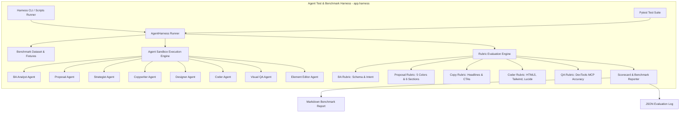

# Technical Design Spec: Agent Test & Benchmark Evaluation Harness

**Date:** 2026-10-28  
**Author:** Antigravity Team  
**Status:** Approved  
**Scope:** Standalone Agent Testing, Quality Rubrics, Benchmark Evaluation Suite, CLI & CI/CD Runner

---

## 1. Context & Business Need

Hệ thống Landing Page Builder hiện sở hữu 8 Agent chuyên sâu:
1. **BA Analyst Agent** (`ba_analyst.py`): Khảo sát và làm rõ yêu cầu nghiệp vụ với 3 câu hỏi cốt lõi.
2. **Proposal Agent** (`proposal_agent.py`): Thiết lập bản đề xuất kiến trúc & thiết kế toàn diện.
3. **Strategist Agent** (`strategist.py`): Xây dựng dàn ý chuyển đổi cao (CRO blueprint).
4. **Copywriter Agent** (`copywriter.py`): Viết tiêu đề, thông điệp giá trị, CTA, social proof, FAQs.
5. **Designer Agent** (`designer.py`): Thiết kế design tokens, bảng màu Tailwind, typography và layout rules.
6. **Coder Agent** (`coder.py`): Lập trình mã nguồn Single-file HTML5 + Tailwind CSS + Lucide Icons + Google Fonts.
7. **Visual QA Agent** (`visual_qa.py`): Kiểm tra cú pháp HTML5 và chạy Chrome DevTools MCP phát hiện lỗi runtime console & mobile overflow.
8. **Element Editor Agent** (`element_editor.py`): Tinh chỉnh chính xác một phần tử DOM được chọn qua DevTools click-to-inspect.

**Vấn đề hiện tại:**
- Khi muốn kiểm tra hoặc cải thiện prompt/model của một Agent cụ thể, nhà phát triển buộc phải kích hoạt toàn bộ workflow LangGraph phức tạp qua API hoặc web UI.
- Chưa có bộ tiêu chí định lượng (Evaluation Rubric) để chấm điểm chất lượng đầu ra của từng Agent (thang điểm 0–100, pass/fail threshold).
- Chưa có bộ dữ liệu chuẩn (Benchmark Datasets) đại diện cho các ngành nghề (B2B SaaS, E-Commerce, Giáo dục trực tuyến, Agency sáng tạo, Edge cases).
- Chưa có CLI Runner để chạy nhanh benchmark, đo thời gian phản hồi (latency), kiểm tra tính hồi quy (regression testing) và xuất báo cáo Markdown/JSON.

---

## 2. Architecture & Design Principles



### 2.1 Core Principles
1. **Isolated Sandboxing:** Chạy độc lập bất kỳ Agent nào với State/Input giả lập mà không phụ thuộc vào các Agent trước đó.
2. **Dual-Mode Execution:**
   - **Mock/Deterministic Mode:** Dùng mock/fixtures cho unit test CI/CD chạy siêu tốc (< 2 giây), 0 chi phí API.
   - **Live LLM Mode:** Gọi trực tiếp LLM model (Gemini 3.8 Flash / Flash-High) để đo lường độ chính xác và benchmark thời gian thực tế.
3. **Objective Grading (0–100 Rubric):** Mỗi Agent có các tiêu chí đánh giá trọng số rõ ràng, trả về điểm số tổng, danh sách tiêu chí đạt/không đạt và cảnh báo lỗi cụ thể.
4. **Rich Reporting:** Xuất bảng tổng kết trực quan trên terminal (màu sắc, bảng biểu) và file báo cáo chi tiết Markdown/JSON.

---

## 3. Rubric Evaluation Engine

Mỗi Agent được chấm điểm theo thang **100 điểm**, ngưỡng đạt tiêu chuẩn (Passing Grade) là **>= 80/100**.

### 3.1 BA Analyst Rubric (100 pts)
- **JSON Format & Schema (30 pts):** Đúng cấu trúc danh sách `BriefQuestion`, chứa `id`, `question`, `quick_options`, `required`.
- **Core Coverage (40 pts):** Bao phủ đủ 3 khía cạnh nghiệp vụ: `target_audience`, `brand_style`, `conversion_goal`.
- **Quick Options Quality (30 pts):** Mỗi câu hỏi có tối thiểu 3 lựa chọn gợi ý ngắn gọn, có ý nghĩa, không rỗng.

### 3.2 Proposal Agent Rubric (100 pts)
- **Schema & Completeness (30 pts):** Đúng schema `DesignProposal`, không rỗng các trường bắt buộc.
- **Color Palette Validity (25 pts):** Đủ 5 màu chuẩn HEX (`primary`, `secondary`, `accent`, `background`, `surface`), regex `#([0-9a-fA-F]{3}){1,2}`.
- **Section Architecture (25 pts):** Tối thiểu 5 sections (bắt buộc có `hero` và `cta`/`final_cta`).
- **Typography & Tone (20 pts):** Khai báo font chữ Google Fonts hợp lệ và định hướng giọng điệu rõ ràng.

### 3.3 Strategist Rubric (100 pts)
- **Section Coverage (50 pts):** Dàn ý có đủ các khối chuyển đổi cốt lõi: Hero, Social Proof, Solution/Features, Testimonials, Pricing/Offer, FAQ, Final CTA.
- **Clarity & Depth (30 pts):** Độ dài phân tích >= 300 ký tự, có mô tả chi tiết cho từng section.
- **Target Audience Alignment (20 pts):** Thể hiện rõ việc nhắm vào phân khúc khách hàng theo prompt.

### 3.4 Copywriter Rubric (100 pts)
- **Headline & Hook (25 pts):** Chứa tiêu đề chính thu hút, tiêu đề phụ giải quyết vấn đề.
- **Clear Call-to-Action (25 pts):** Có nút hành động rõ ràng và định hướng hành động (Action-driven).
- **Social Proof & Value Props (30 pts):** Có số liệu tin cậy, lời chứng thực hoặc cam kết.
- **FAQ Section (20 pts):** Tối thiểu 3 câu hỏi thường gặp giải tỏa băn khoăn của khách hàng.

### 3.5 Designer Rubric (100 pts)
- **Color Token Definitions (30 pts):** Khai báo mã màu HEX hoặc Tailwind palette cụ thể.
- **Typography Guidance (25 pts):** Hướng dẫn rõ ràng font tiêu đề và font nội dung.
- **Layout & Spacing Specs (25 pts):** Đề xuất class Tailwind về padding, max-width, grid/flex.
- **Visual Effects (20 pts):** Đề xuất gradient, shadow, glassmorphism phù hợp phong cách.

### 3.6 Coder Rubric (100 pts)
- **HTML5 Compliance (30 pts):** Chứa `<!DOCTYPE html>`, `<html lang=...>`, `<head>`, `<meta name="viewport" ...>`, `<body>`, `</html>`.
- **CDN Dependencies (25 pts):** Chứa thẻ script nạp Tailwind CDN (`cdn.tailwindcss.com`) và Lucide Icons (`unpkg.com/lucide`).
- **Semantic DevTools IDs (20 pts):** Có các section với ID chuẩn (`id="hero"`, `id="features"`, `id="cta"`...).
- **Lucide Initialization & Responsiveness (15 pts):** Có script `lucide.createIcons()` và các tiền tố responsive (`sm:`, `md:`, `lg:`).
- **Clean Code (10 pts):** Không sót ký tự markdown code fence dư thừa hoặc thẻ đóng bị thiếu.

### 3.7 Visual QA Rubric (100 pts)
- **Structure Audit Accuracy (40 pts):** Phát hiện chính xác nếu HTML bị thiếu DOCTYPE hoặc Tailwind CDN.
- **Chrome DevTools Integration (40 pts):** Trả về đầy đủ telemetry audit: `console_errors_count`, `has_overflow`, `mobile_viewport`.
- **Verdict Consistency (20 pts):** Trả về `qa_passed=True` khi không có lỗi, `qa_passed=False` khi có lỗi cú pháp hoặc runtime.

### 3.8 Element Editor Rubric (100 pts)
- **Targeted Output (40 pts):** Chỉ trả về đoạn mã HTML của phần tử mục tiêu (không xuất toàn trang).
- **Instruction Adherence (30 pts):** Áp dụng đúng màu sắc/chữ mới theo yêu cầu chỉnh sửa.
- **Structure Integrity (30 pts):** Cú pháp thẻ HTML hợp lệ, đóng mở thẻ đúng chuẩn, giữ lại ID nếu có.

---

## 4. Benchmark Datasets & Fixtures

Bộ dữ liệu Benchmark gồm 5 kịch bản chuẩn đại diện:
1. `b2b_saas`: "TalentAI - Nền tảng AI tự động sàng lọc và phỏng vấn ứng viên công nghệ hàng đầu."
2. `ecommerce_fashion`: "StreetVibe - Thương hiệu thời trang dạo phố phong cách Cyberpunk trẻ trung, năng động."
3. `online_education`: "ProDev Bootcamp - Khóa học lập trình Full-Stack Web thực chiến từ con số 0 trong 12 tuần."
4. `creative_agency`: "NovaStudio - Agency thiết kế nhận diện thương hiệu và giải pháp tiếp thị kỹ thuật số cao cấp."
5. `edge_cases`:
   - Prompt tối thiểu: "Quán cà phê"
   - Bad HTML test case cho Visual QA: HTML thiếu `</html>`, thiếu Tailwind CDN, script gây lỗi `console.error()`, phần tử `w-[1200px]` gây tràn màn hình 375px.
   - Element Tweak case cho Editor: Sửa nút CTA sang màu gradient cam bo tròn.

---

## 5. File Structure Map

```text
backend/app/harness/
├── __init__.py          # Export các class chính: AgentHarness, TestCase, Rubrics
├── models.py            # Pydantic models: TestCase, EvaluationResult, BenchmarkSuiteResult
├── rubrics.py           # Engine chấm điểm 8 Agent (0-100 pts theo tiêu chí cụ thể)
├── fixtures.py          # Tập dữ liệu benchmark chuẩn (B2B SaaS, E-commerce, EdTech, Agency, Edge cases)
├── runner.py            # Execution engine chạy từng agent hoặc toàn bộ suite
└── cli.py               # CLI tool: python -m app.harness.cli [--agent ...] [--case ...] [--live] [--report ...]

backend/tests/
├── test_harness_rubrics.py  # Unit tests cho logic chấm điểm rubrics
└── test_agent_harness.py    # Integration tests cho harness runner với mock và live inputs

scripts/
└── run_agent_benchmark.py   # Script tiện ích chạy benchmark, in kết quả và xuất báo cáo Markdown
```

---

## 6. Verification & Acceptance Criteria
1. Tất cả unit test cho Rubrics và Harness runner đạt 100% pass với `pytest`.
2. Chạy thử nghiệm CLI với `--mock` hoàn thành trong < 2 giây, chấm điểm đầy đủ cả 8 Agent.
3. Chạy thử nghiệm Live benchmark trên case `b2b_saas` và `edge_cases`, xuất báo cáo `docs/benchmarks/benchmark_latest.md`.
4. Toàn bộ mã nguồn tuân thủ Typing Pydantic, không rò rỉ API key, xử lý ngoại lệ graceful.
